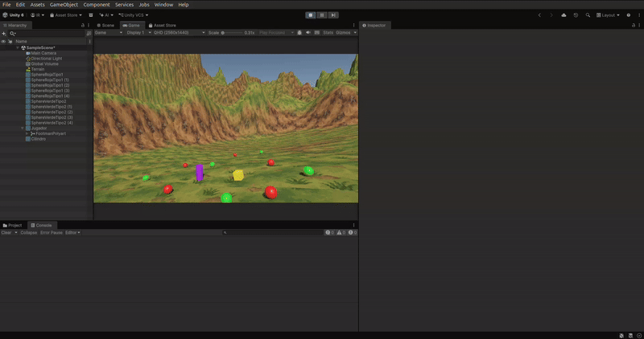
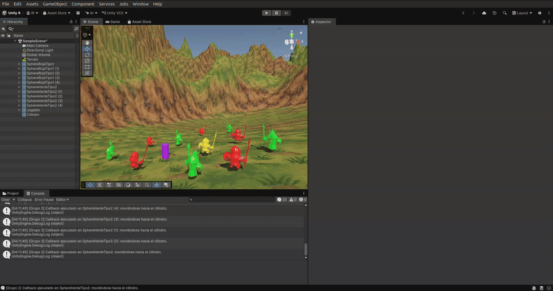
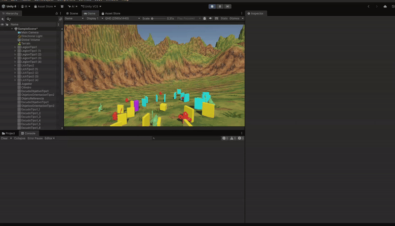
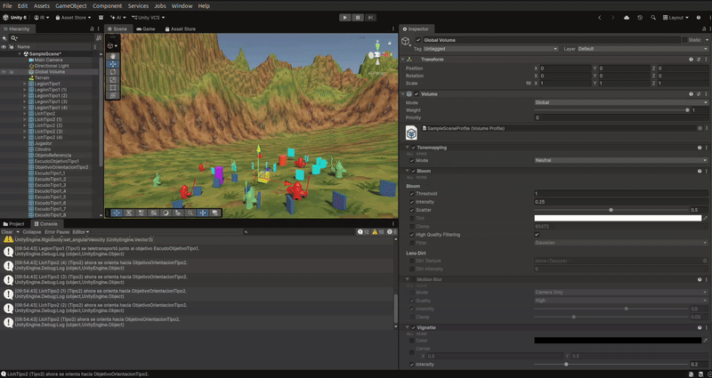
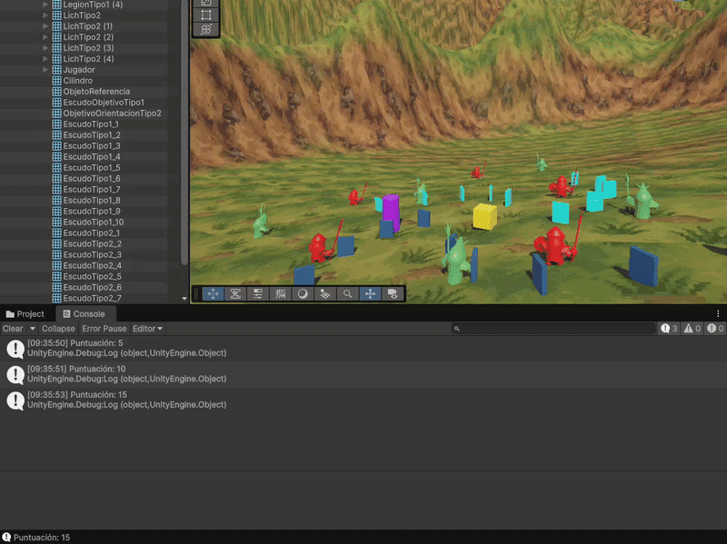
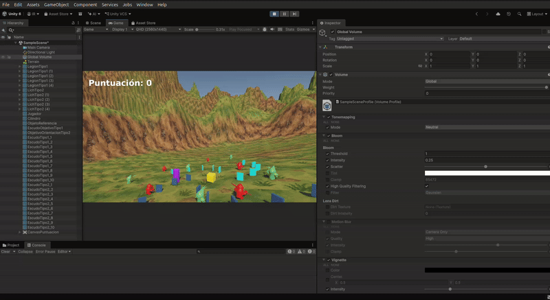
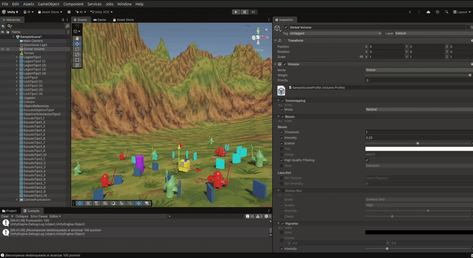

# Práctica 4 — Física, eventos y escudos en Unity

Proyecto de Unity con un jugador físico, dos grupos de humanoides (Legion tipo 1 y Lich tipo 2), eventos de colisión, escudos recolectables, puntuación e interfaz.

## Hitos de la práctica

1. **Eventos de colisión:** el cilindro morado notifica al jugador; los humanoides escuchan el evento y reaccionan según su tipo.
2. **Grupos de humanoides:** la escena contiene cinco Legion y cinco Lich, representados con sus prefabs.
3. **Respuesta a contactos:** al tocar un Lich, los Legion van hacia el escudo tipo 1 seleccionado. Al tocar un Legion, van hacia los escudos del tipo 2. El contacto de un humanoide con un escudo tipo 2 cambia su color.
4. **Objeto de referencia:** al acercarse el jugador al objeto de referencia naranja, los Legion se teletransportan junto al escudo objetivo tipo 1 y los Lich se orientan hacia el marcador de la escena.
5. **Recogida y puntuación:** recoger un escudo tipo 1 suma 5 puntos y uno tipo 2 suma 10; la puntuación aparece en el Canvas y también se registra en la consola.
6. **Recompensas:** cada vez que se alcanzan otros 100 puntos, la interfaz muestra una recompensa.
7. **Escena física:** el jugador es un objeto con `Rigidbody` y se controla con las teclas indicadas abajo.

## Ejecución

- Abrir el ZIP del proyecto completo con **Unity 6000.6.6f1**.
- Abrir `Assets/Scenes/SampleScene.unity` y pulsar **Play**.
- Mover el jugador con **WASD** o las **flechas**.
- Recoger escudos para comprobar la puntuación y alcanzar 100 puntos para ver una recompensa.

El proyecto completo (escena, ajustes, materiales y assets usados) se entrega en el ZIP aparte. Este repositorio contiene los scripts relevantes y las pruebas animadas para mantener la entrega GitHub ligera.

## Pruebas de ejecución

Los GIF muestran la ejecución en Unity:

| Prueba | Evidencia |
|---|---|
| Escena y colisión |  |
| Respuesta de los humanoides |  |
| Escudos y movimiento |  |
| Actualización de puntuación |  |
| Prueba de recogida |  |
| Interfaz y recogida |  |
| Recompensas por puntuación |  |

## Scripts

- `CilindroEvento.cs`: detecta el contacto del jugador y publica el evento.
- `MovimientoEsfera.cs`: configura la representación Legion/Lich, gestiona los objetivos, movimientos, colisiones y cambios de color.
- `ObjetoReferenciaEvento.cs`: detecta la proximidad del jugador y avisa a los humanoides.
- `EscudoRecolectable.cs`: gestiona la recogida de cada tipo de escudo.
- `ControlJugador.cs`: movimiento físico, preparación de elementos de escena, Canvas, puntuación y recompensas.

## Nota sobre los escudos

Los objetos funcionales de los dos tipos se generan como cubos con colliders y se distinguen por color. No se ha incluido un modelo 3D de escudo del Asset Store; el paquete visual de Legion y Lich sí forma parte del ZIP del proyecto.
